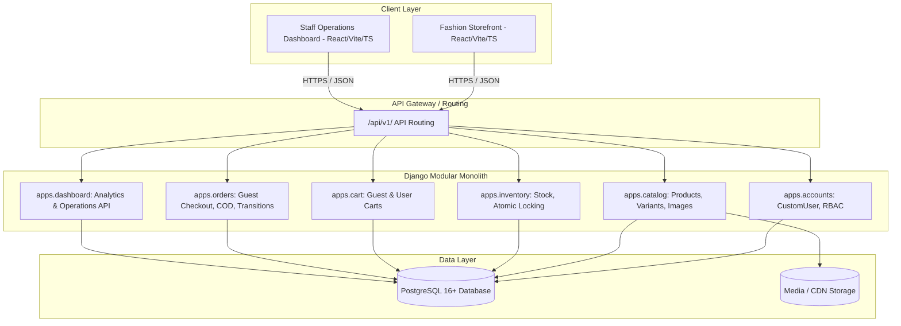

# Architecture Specification

## 1. Architectural Philosophy & Overview

FineFit is designed as an **API-first modular monolith**.
- **Backend**: Built with Django and Django REST Framework (DRF), backed by a relational PostgreSQL database.
- **Frontend**: A decoupled, high-performance Single Page Application (SPA) built with React, TypeScript, Vite, and Tailwind CSS.
- **Communication Protocol**: Stateless JSON APIs adhering to semantic REST principles under the versioned route `/api/v1/`.



---

## 2. Domain Data Models & Schema Design

### 2.1 Accounts & RBAC (`apps.accounts`)
- **`CustomUser`**:
  - `id`: UUID primary key (provides unguessable identifiers against sequential enumeration; does not substitute for authorization).
  - `email`: `EmailField(unique=True)` (primary authentication identity, normalized to lowercase with database-level `UniqueConstraint(Lower('email'))`).
  - `phone_number`: `CharField(max_length=20, null=True, blank=True)`.
  - `first_name`, `last_name`: `CharField`.
  - `is_active`, `is_staff`, `is_superuser`: Standard Django boolean flags.
  - `groups`, `user_permissions`: Django's standard Groups and Permissions model for flexible RBAC. Public customer access, staff authorization, and Django's `is_staff` flag are kept conceptually separate without a hard-coded single role enum.
- **`Address`**:
  - `id`: UUID
  - `user`: ForeignKey to `CustomUser` (`null=True` for guest addresses)
  - `recipient_name`, `phone_number`, `street_address`, `city`, `postal_code`, `country`, `is_default`.

### 2.2 Catalog & Product Variants (`apps.catalog`)
- **`Category`**:
  - `id`: BigAutoField
  - `name`: `CharField`
  - `slug`: `SlugField(unique=True)`
  - `parent`: `ForeignKey('self', null=True, blank=True, related_name='children')`
  - `is_active`: `BooleanField(default=True)`
- **`Product`**:
  - `id`: UUID
  - `title`: `CharField(max_length=255)`
  - `slug`: `SlugField(unique=True)`
  - `description`: `TextField`
  - `category`: `ForeignKey(Category, related_name='products')`
  - `base_price`: `DecimalField(max_digits=10, decimal_places=2)`
  - `is_published`: `BooleanField(default=False)`
  - `created_at`, `updated_at`: `DateTimeField`
- **`ProductImage`**:
  - `id`: BigAutoField
  - `product`: `ForeignKey(Product, related_name='images')`
  - `variant`: `ForeignKey('ProductVariant', null=True, blank=True, related_name='images')`
  - `image`: `ImageField(upload_to='products/%Y/%m/')`
  - `alt_text`: `CharField`
  - `is_primary`: `BooleanField(default=False)`
  - `display_order`: `PositiveIntegerField(default=0)`
- **`ProductVariant`**:
  - `id`: UUID
  - `product`: `ForeignKey(Product, related_name='variants')`
  - `sku`: `CharField(max_length=64, unique=True)`
  - `size`: `CharField(max_length=32)` (e.g., XS, S, M, L, XL, 32R)
  - `color_name`: `CharField(max_length=64)` (e.g., "Navy Blue")
  - `color_code`: `CharField(max_length=7)` (e.g., "#000080" for swatches)
  - `price_override`: `DecimalField(max_digits=10, decimal_places=2, null=True, blank=True)`
  - `is_active`: `BooleanField(default=True)`

### 2.3 Inventory (`apps.inventory`)
- **`StockRecord`**:
  - `id`: BigAutoField
  - `variant`: `OneToOneField(ProductVariant, related_name='stock_record')`
  - `quantity`: `PositiveIntegerField(default=0)`
  - `low_stock_threshold`: `PositiveIntegerField(default=5)`
  - `updated_at`: `DateTimeField(auto_now=True)`

### 2.4 Shopping Cart (`apps.cart`)
- **`Cart`**:
  - `id`: UUID
  - `user`: `ForeignKey(CustomUser, null=True, blank=True, related_name='carts')`
  - `session_key`: `CharField(max_length=64, null=True, blank=True, db_index=True)`
  - `created_at`, `updated_at`: `DateTimeField`
- **`CartItem`**:
  - `id`: BigAutoField
  - `cart`: `ForeignKey(Cart, related_name='items')`
  - `variant`: `ForeignKey(ProductVariant, on_delete=models.CASCADE)`
  - `quantity`: `PositiveIntegerField(default=1)`
  - *UniqueConstraint* on `(cart, variant)`.

### 2.5 Orders & Fulfillment (`apps.orders`)
- **`Order`**:
  - `id`: UUID
  - `order_number`: `CharField(max_length=32, unique=True)` (e.g., `ORD-2026-XXXX`)
  - `user`: `ForeignKey(CustomUser, null=True, blank=True, related_name='orders')`
  - `customer_name`: `CharField(max_length=255)`
  - `customer_email`: `EmailField(blank=True)`
  - `customer_phone`: `CharField(max_length=20)`
  - `shipping_address`: `JSONField` (snapshot of full address)
  - `payment_method`: `CharField(choices=[('COD', 'Cash on Delivery')])`
  - `status`: `CharField(choices=['PENDING', 'CONFIRMED', 'PROCESSING', 'SHIPPED', 'DELIVERED', 'CANCELLED', 'RETURNED'])`
  - `subtotal`: `DecimalField(max_digits=10, decimal_places=2)`
  - `shipping_fee`: `DecimalField(max_digits=10, decimal_places=2, default=0.00)`
  - `total`: `DecimalField(max_digits=10, decimal_places=2)`
  - `created_at`, `updated_at`: `DateTimeField`
- **`OrderItem`**:
  - `id`: BigAutoField
  - `order`: `ForeignKey(Order, related_name='items')`
  - `variant`: `ForeignKey(ProductVariant, null=True, on_delete=models.SET_NULL)`
  - `product_title`: `CharField(max_length=255)` (snapshot)
  - `variant_sku`: `CharField(max_length=64)` (snapshot)
  - `size`: `CharField(max_length=32)` (snapshot)
  - `color_name`: `CharField(max_length=64)` (snapshot)
  - `unit_price`: `DecimalField(max_digits=10, decimal_places=2)` (snapshot)
  - `quantity`: `PositiveIntegerField`
  - `line_total`: `DecimalField(max_digits=10, decimal_places=2)`

---

## 3. Concurrency & Inventory Atomic Operations

To prevent overselling when multiple shoppers purchase the same limited-inventory fashion variant:

```python
# Conceptual transaction block in apps.orders.services.order_service
from django.db import transaction
from apps.inventory.models import StockRecord

@transaction.atomic
def process_order_checkout(cart, checkout_data):
    # 1. Lock stock records for all variants in the cart
    variant_ids = [item.variant_id for item in cart.items.all()]
    stock_records = {
        sr.variant_id: sr
        for sr in StockRecord.objects.select_for_update().filter(variant_id__in=variant_ids)
    }

    # 2. Verify availability
    for item in cart.items.all():
        record = stock_records.get(item.variant_id)
        if not record or record.quantity < item.quantity:
            raise InsufficientStockException(f"Variant {item.variant.sku} is out of stock.")

    # 3. Decrement stock
    for item in cart.items.all():
        stock_records[item.variant_id].quantity -= item.quantity
        stock_records[item.variant_id].save(update_fields=['quantity', 'updated_at'])

    # 4. Create immutable order and line items
    order = create_order_records(cart, checkout_data)
    
    # 5. Clear cart
    cart.items.all().delete()
    return order
```

---

## 4. REST API Specification (`/api/v1/`)

### Authentication & Profiles (Session Auth + CSRF)
- `GET /api/v1/auth/csrf/` - Establish/refresh CSRF cookie (`csrftoken`)
- `POST /api/v1/auth/login/` - Authenticate via email/password and establish HttpOnly session
- `POST /api/v1/auth/logout/` - Terminate authenticated session
- `GET /api/v1/auth/me/` - Retrieve authenticated user profile
- `GET|POST /api/v1/auth/addresses/` - Address book management

### Catalog
- `GET /api/v1/catalog/categories/` - Category tree hierarchy
- `GET /api/v1/catalog/products/` - Filtered list (category, size, color, price range, search)
- `GET /api/v1/catalog/products/{slug}/` - Detailed product view with all variants, images, and live stock flags

### Cart
- `GET /api/v1/cart/` - Retrieve active cart (authenticated or session guest)
- `POST /api/v1/cart/items/` - Add variant to cart with specified quantity
- `PATCH /api/v1/cart/items/{id}/` - Update quantity
- `DELETE /api/v1/cart/items/{id}/` - Remove item
- `POST /api/v1/cart/merge/` - Merge guest session cart into user cart on login

### Checkout & Orders
- `POST /api/v1/orders/checkout/` - Submit order (Supports guest & registered; COD validation)
- `GET /api/v1/orders/` - Customer order history
- `GET /api/v1/orders/{order_number}/` - Specific order details (isolated by ownership or guest verification token)

### Staff Dashboard Operations (`/api/v1/dashboard/`)
- `GET /api/v1/dashboard/orders/` - Staff order list with status filters & search
- `PATCH /api/v1/dashboard/orders/{id}/status/` - Advance order status (e.g., Pending -> Confirmed -> Shipped)
- `GET|POST /api/v1/dashboard/products/` - Product management
- `PATCH /api/v1/dashboard/inventory/{variant_id}/` - Adjust stock levels

---

## 5. Security & Isolation Architecture

1. **Owner-Only QuerySet Filtering**:
   ```python
   class CustomerOrderViewSet(viewsets.ReadOnlyModelViewSet):
       serializer_class = OrderSerializer
       permission_classes = [permissions.IsAuthenticated]

       def get_queryset(self):
           # Strict customer isolation
           return Order.objects.filter(user=self.request.user).prefetch_related('items')
   ```
2. **Staff Permission Isolation**:
   - Custom permission classes (e.g., `IsStaffRole`, `IsInventoryManager`) inspect the user's role and Django group memberships before allowing access to `/api/v1/dashboard/`.
3. **Guest Session Protection**:
   - Guest carts use secure, high-entropy tokens passed in headers (`X-Cart-Session`) or secure HttpOnly cookies, validated against cryptographic hashing.
4. **UUID Identifiers vs. Authorization Boundary**:
   - Primary keys use UUIDv4 to eliminate predictable sequential integer IDs and mitigate trivial URL scraping/enumeration.
   - **Crucial Rule**: UUIDs do **NOT** replace authentication, authorization, object-level permission checks, or customer data isolation. Possessing a UUID must never grant access to a resource; every API endpoint must enforce tenant/ownership QuerySet filtering (`filter(user=request.user)`) and backend permission classes.
